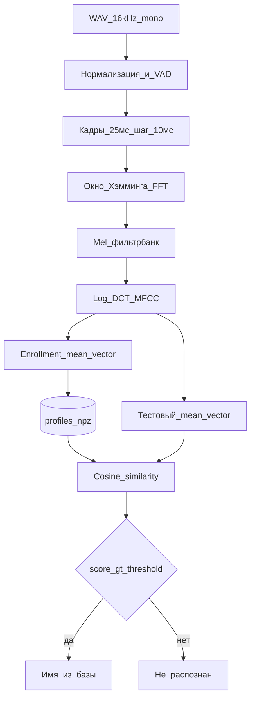

# КП: идентификация личности по голосу

## Решения (зафиксировано)

- **Сдача:** пояснительная записка + рабочий прототип + презентация.
- **Стек:** Python 3; своя база голосов бригады (3 человека + 1–2 «чужих» для отказа).
- **Алгоритм:** MFCC → усреднённый **голосовой слепок** → cosine similarity + порог. Лёгкий GMM (8 компонент, только `numpy`) — второй этап, если останется время; для защиты достаточно слепка.
- **Библиотеки (минимум):** `numpy`, `scipy` (WAV + FFT), `matplotlib` (графики в записку), `tkinter` (GUI из stdlib). Без librosa / SpeechBrain / sklearn — признаки и сравнение пишем сами, чтобы объяснить на защите.
- **Режим:** text-independent (любая фраза ~3–5 с); идентификация 1:N по базе + отказ при низком score.

## Связь с курсом «Мультимедийные системы»

Использовать в теории и в пояснениях к коду:

- **Лекция 3** — АЦП, частота дискретизации, теорема Котельникова; для речи достаточно 8–16 кГц; 16 бит; запись с микрофона.
- **Лекция 4** — тембр = основной тон + обертоны; «окраска» спектра ≈ то, что кодирует голосовой слепок.
- **Лекция 13** — формат WAV; спектральный анализ через FFT (аналог Spectrum Analysis в Sound Forge).
- **Лекция 17** — каркас записки: тема → анализ → сценарий/модель → выбор ПО → синтез модели (реализация).

## Архитектура прототипа

**Структура репозитория** (в [`/Users/vladimirpocepaj/Study/ПИД ЖИГАЛОВ`](/Users/vladimirpocepaj/Study/ПИД%20ЖИГАЛОВ)):

- `data/raw/<speaker_id>/*.wav` — записи
- `data/profiles/<speaker_id>.npy` — слепки
- `src/audio_io.py` — загрузка WAV, ресемплинг при необходимости
- `src/preprocess.py` — нормализация, energy VAD
- `src/features.py` — framing, FFT, mel, MFCC (**свой код**)
- `src/enroll.py` / `src/identify.py` — слепок и сравнение
- `src/metrics.py` — accuracy, FAR/FRR на тестовом наборе
- `app/gui.py` — простое окно: запись/файл → enroll / identify
- `notebooks/` или `scripts/plots.py` — спектрограмма, MFCC heatmap для записки
- `docs/` — записка (`.docx`/`.md`), презентация

**Параметры по умолчанию (зафиксировать в коде и записке):** `fs=16000`, окно 25 мс, hop 10 мс, 26 mel-фильтров, 13 MFCC (без C0 или с C0 — выбрать одно и не менять), порог cosine подбирать на валидации (~0.7–0.9).

## Роли бригады (3 человека)

| Роль | Кто делает | Артефакты |
|------|------------|-----------|
| **A — DSP / признаки** | Теория звука + `features.py`, `preprocess.py`, графики спектр/MFCC | Гд. 2–3 записки, демо «как выглядит слепок» |
| **B — Система / UI** | `enroll`/`identify`, база профилей, GUI, сбор датасета | Рабочий прототип, инструкция запуска |
| **C — Эксперименты / защита** | Протокол записей, метрики, порог, текст записки + презентация | Гд. 4–5, слайды, сценарий защиты |

Все трое участвуют в записи голосов (по 8–12 фраз на человека: enroll 5–7, test 3–5; плюс шум/другая комната — 2–3 файла).

## Календарь (~8 недель)

1. **Неделя 1** — ТЗ, обзор методов (MFCC, слепок vs GMM vs i-vector — кратко), критерии успеха; план записки по лекции 17.
2. **Неделя 2** — Сбор WAV: тихая комната, одна фраза ≠ заученная пароль-фраза; единый формат 16 kHz mono 16-bit WAV.
3. **Недели 3–4** — Конвейер признаков; проверка: спектрограммы разных людей визуально отличаются; unit-smoke на одном файле.
4. **Неделя 5** — Enrollment + identify + порог; CLI работает end-to-end.
5. **Неделя 6** — GUI + метрики на полном наборе; таблица FAR/FRR; подбор порога.
6. **Неделя 7** — Записка (теория ↔ лекции ↔ блок-схемы ↔ скрины), опционально простой GMM.
7. **Неделя 8** — Презентация, репетиция защиты, фикс багов, README.

## Содержание записки (каркас)

1. Введение, постановка задачи, различие identification / verification / ASR.
2. Анализ объекта: речь как сигнал; тембр (лек. 4); оцифровка (лек. 3); WAV (лек. 13).
3. Обзор методов: признаки (MFCC), модели (слепок, GMM); обоснование выбора слепка для семестрового прототипа.
4. Проектирование: архитектура, сценарии enroll/identify, структуры данных, UI.
5. Реализация: стек, параметры, скриншоты.
6. Эксперименты: датасет, метрики, влияние шума/микрофона, ограничения.
7. Заключение, список источников (открытые статьи + лекции курса).

Объём ориентир: **25–40 стр.** без приложений (уточнить у ЖИГАЛОВА).

## Презентация (~10–12 слайдов)

Тема → проблема → блок-схема → MFCC «на пальцах» + отсылка к спектру/тембру → демо (видео/живой) → метрики → выводы / что улучшать (GMM, x-vector).

## Критерий «готово»

- Три человека в базе стабильно узнаются на своих test-фразах.
- Чужой голос / тишина → «не распознан».
- На защите можете объяснить: зачем FFT, что такое mel/MFCC, что хранится в `.npy`, как считается cosine и порог — **без** «чёрного ящика» нейросети.

## Что сознательно не делаем

Нет pretrained embeddings, нет веб-сервера, нет anti-spoofing, нет text-dependent пароля — чтобы уложиться в семестр и сохранить объяснимость.